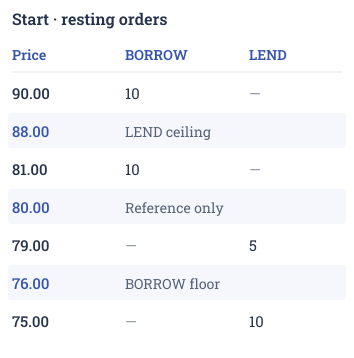
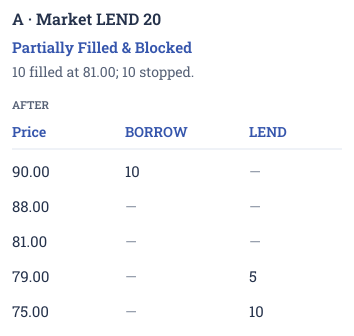
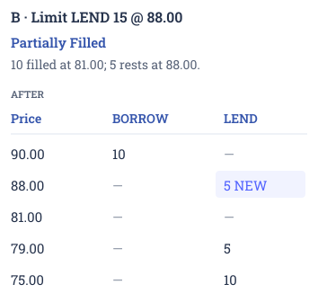
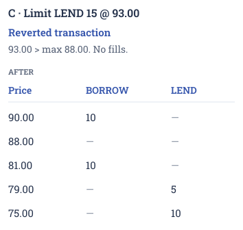

# 🪃 Order Life Cycle

Track your orders in the Order History tab of the [Portfolio](../getting-started/platform-guide/portfolio.md) page. The lifecycle below shows what happens to your order and its unfilled amount. Completed fills change your position, even when the rest of the order ends.

This page covers continuous trading. Pre-orders and the opening auction follow the separate [Itayose process](../advanced-topics/itayose.md).

LEND and BORROW are protocol order-side terms. In the app, Lend / Buy buys ZC bonds and Borrow / Sell sells them. The examples below use the protocol terms.

## Before an order is accepted

A new limit order must be within the permitted price range for lending or borrowing. If its price is outside that range, the transaction is rejected before any part fills, even if matching liquidity is available at permitted prices. It does not become an Open or Blocked order.

Market orders match available prices within the circuit breaker's limits. If there are no orders on the opposite side of the book, the transaction is rejected.

Available funds, collateral and other checks must also pass. If any check fails, the transaction is rolled back: none of its fills or order changes take effect. A failed transaction may still cost gas.

Check the current [Circuit Breaker](../advanced-topics/circuit-breaker.md) and [Protocol Parameters](../protocol-parameters.md#order-price-validation) before retrying.

## Order states and transitions

The lifecycle is based on limit orders. A market order is a convenient way to match available orders in one transaction instead of placing several limit orders. It uses the same fill outcomes, but never leaves an unfilled amount waiting on the book.

After a successful submission, a limit order can be Open, Partially Filled or Filled, depending on how much matched immediately.

<figure><figcaption>
Order status transitions
</figcaption></figure>

### What each label means

| Displayed label                                  | Order type | Unfilled amount                                           | Filled amount                               |
| ------------------------------------------------ | ---------- | --------------------------------------------------------- | ------------------------------------------- |
| **Open**                                         | Limit      | Resting on the book                                       | None                                        |
| **Partially Filled**                             | Limit      | Resting on the book                                       | Creates or changes a position               |
| **Filled**                                       | Both       | None                                                      | Entire executed amount changes the position |
| **Blocked**                                      | Market     | Terminated at the execution price bound                   | None                                        |
| **Partially Filled & Blocked**                   | Market     | Terminated at the execution price bound                   | Executed amount changes the position        |
| **Partially Filled & Killed**                    | Market     | Terminated when opposite-side liquidity is exhausted      | Executed amount changes the position        |
| **Cancelled** / **Partially Filled & Cancelled** | Limit      | Cancelled                                                 | Completed fills are not reversed            |
| **Expired** / **Partially Filled & Expired**     | Limit      | No longer executable; released through accounting cleanup | Completed fills are not reversed            |

A fill changes your net position for that currency and maturity. It can open or increase exposure, or reduce or close an existing opposite-side position after fees. Ending the unfilled remainder does not reverse completed fills.

Matching moves an Open order to Partially Filled or Filled. Further matching can keep a partially filled order in that state or complete it. Cancellation and market inactivity affect only the unfilled remainder.

A later change to the circuit-breaker limit does not kill or block an already resting limit order. Once no unfilled amount remains available to trade, that order cannot receive further fills.

At maturity, an unfilled amount can no longer trade. Order History may show Expired or Partially Filled & Expired only after the app receives the market's updated status.

## Scenario walkthrough

Each example below starts from the same illustrative book and assumes all other checks pass. The shared reference is **80.00** and the configured base percentage is **5%**, giving a LEND upper threshold of **88.00** and a BORROW lower threshold of **76.00**.

LEND means buying ZC bonds; BORROW means selling ZC bonds. Example amounts are amounts of funds (**Present Value**), not numbers of ZC bonds. These values illustrate the rules, not a live market configuration.

<figure><figcaption>
Starting book for every case. Highlighted rows are the side-specific execution thresholds and reference, not resting orders.
</figcaption></figure>

The starting book, in text form:

| Price | Resting BORROW offers (PV) | Resting LEND bids (PV) |
| ----- | -------------------------- | ---------------------- |
| 90.00 | 10                         |                        |
| 81.00 | 10                         |                        |
| 79.00 |                            | 5                      |
| 75.00 |                            | 10                     |

### Market orders

<figure><figcaption>
Case A: the offer at 90.00 is beyond the LEND execution ceiling of 88.00. The unfilled amount is stopped, not posted to the book.
</figcaption></figure>

* LEND 10 at market fills 10 at 81.00: **Filled**.
* LEND 20 at market fills 10 at 81.00. The offer at 90.00 exceeds the LEND threshold, so the remainder is **Blocked**: **Partially Filled & Blocked**. No remainder rests on the book.
* BORROW 10 at market fills 5 at 79.00. The bid at 75.00 is below the BORROW threshold, so the remainder is **Blocked**: **Partially Filled & Blocked**.
* If the only BORROW offer were 10 at 81.00, LEND 20 at market would fill those 10 and exhaust the opposite-side book: **Partially Filled & Killed**.
* If the only BORROW offer were at 90.00, a market LEND would have no executable price at or below 88.00: Blocked, with no fill. If there were no BORROW offers at all, the transaction would instead be rejected.

### Limit orders

<figure><figcaption>
Case B: the valid limit order partially fills, then posts the remaining 5 at 88.00.
</figcaption></figure>

* LEND 10 at 81.00 fills immediately: **Filled**.
* LEND 15 at 88.00 fills 10 at 81.00; the remaining 5 rest at 88.00: **Partially Filled**.

<figure><figcaption>
Case C: the price fails validation before matching. The starting book is unchanged.
</figcaption></figure>

* LEND 15 at 93.00 exceeds the accepted LEND maximum of 88.00: the transaction **reverts before any fill** and leaves the book unchanged.
* BORROW 10 at 75.00 is below the accepted BORROW minimum of 76.00: the transaction **reverts before any fill**.
* LEND 10 at 75.00 is valid but does not cross a BORROW offer: **Open**. The BORROW lower threshold does not restrict this passive LEND price.
* BORROW 10 at 90.00 is valid but does not cross a LEND bid: **Open**. The LEND upper threshold does not restrict this passive BORROW price.

## Position accounting

[Genesis Value](../advanced-topics/orderbook-deep-dive/genesis-value-and-compound-factor.md) is the normalized accounting unit used to track positions across auto-rolls.

<figure><figcaption>
Filled amounts change Future Value (FV), the position's accounting value at maturity. This is not an automatic wallet payout.
</figcaption></figure>

## Common questions

What's the difference between Killed, Blocked and rejected?

Killed and Blocked describe an unfilled amount terminated during market-order execution. Killed means the opposite-side book ran out of liquidity; Blocked means the applicable execution threshold prevented further matching. Completed fills are not reversed.

An invalid limit price is rejected before matching. More generally, if any transaction check fails, the whole transaction reverts: it creates no new fill or resting order.

What happens when the market matures?

Unfilled orders can no longer execute. Their reserved amounts are released through accounting cleanup. Any remaining position follows the relevant [Auto-Roll](fixed-maturity-and-auto-roll.md) and maturity rules. The Expired label appears after the app receives the updated market status, so it may not change at the exact maturity time.

Can I modify an order?

To change a resting limit order, cancel its unfilled remainder and place a new order:

1. Check the latest filled and unfilled amounts and your current position in Portfolio. If the order has fully filled, there is no remainder to replace.
2. Cancel the unfilled remainder. Wait for the cancellation transaction to be confirmed, then verify that the original order is no longer live.
3. Refresh Order History and your positions to include any fills that occurred before cancellation. Place a replacement only for the amount you still want to trade, using your updated exposure rather than automatically repeating the original amount.

If the cancellation or an earlier order transaction is pending or its outcome is uncertain, check its transaction receipt and updated order state before submitting a duplicate or replacement.

Cancellation does not reverse completed fills. The replacement receives a new position in price-time priority and must satisfy the price range and other checks applicable when submitted.

Why can an expired order later show Cancelled?

Order History combines completed fills with the status of the unfilled remainder. An expired remainder may still be cancellable. If that cancellation succeeds, the label changes to Cancelled or Partially Filled & Cancelled, without reopening trading or undoing any fills.

Cancellation availability depends on whether that remainder is still recorded and the cancellation checks pass. Refresh the order and transaction status before acting.

