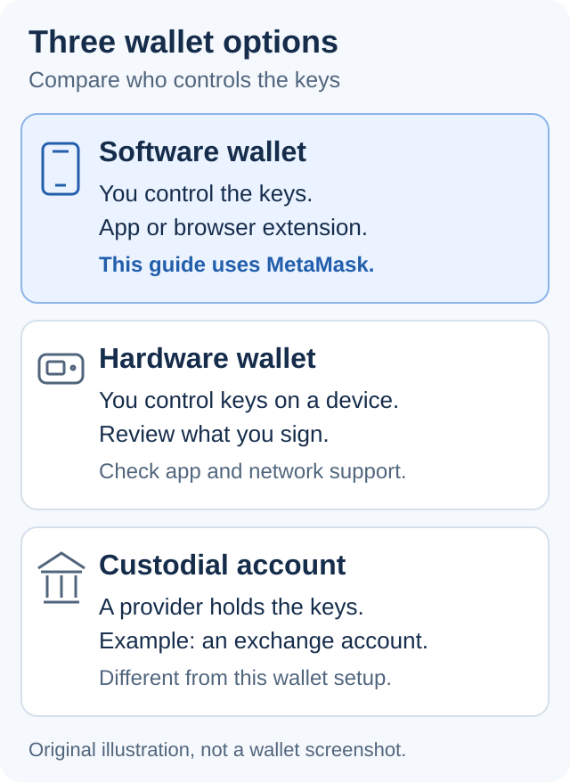

# 👛 Wallet Setup

## Overview

A wallet lets you receive assets and approve transactions on a blockchain. This guide uses MetaMask to get you ready for Secured Finance.

**New wallet?** Start with [Step 1](wallet-setup.md#id-1.-choose-your-wallet-type). **Already have a compatible wallet?** Go to [network setup](wallet-setup.md#id-5.-configure-network-settings), then check funding and gas.

## How It Works

Optional background: keys and wallet types

Cryptocurrency wallets use cryptographic keys to control an account:

1. **Public Address**: Derived from a public key and used to receive assets. Share your address, not your private key
2. **Private Key**: The secret code that gives you control over the assets (similar to a password, but cannot be reset if lost)

When you "create a wallet," you're generating these keys and establishing an interface to interact with them. Your assets always remain on the blockchain, with your wallet providing the authorization to move or manage them.

### Types of Wallets

There are several types of wallets, each with different security and convenience tradeoffs:

* **Hardware Wallets**: Physical devices that keep private keys offline; you must still verify what you sign
* **Software Wallets**: Applications installed on computers or smartphones
* **Web Wallets**: Browser-based interfaces that can be accessed from any device
* **Paper Wallets**: Physical documents containing printed keys (rarely used now)
* **Custodial Wallets**: Services where a third party holds your keys (like exchange accounts)

## Step-by-Step Wallet Setup

### 1. Choose Your Wallet Type

This walkthrough uses MetaMask, a non-custodial software wallet that can connect to Ethereum, Arbitrum One and Filecoin. If you already use a compatible wallet, keep using it and skip to network setup. You do not need a new wallet for each product.

<figure><figcaption>
Three common wallet options. This guide uses MetaMask, a non-custodial software wallet.
</figcaption></figure>

### 2. Install the Wallet

Start at the [official MetaMask download page](https://metamask.com/download) and follow its link to your browser's extension store or your phone's app store. Avoid download links in advertisements or unsolicited messages.

* **Desktop:** Install the browser extension, then open it from your browser's extensions menu.
* **Mobile:** Install the app. When you later connect to a DApp, use the wallet's in-app browser or a connection method supported by that DApp.

For screenshots of the current setup screens, follow MetaMask's official [installation guide](https://support.metamask.io/start/getting-started-with-metamask) and [wallet creation guide](https://support.metamask.io/start/creating-a-new-wallet/). Screens may vary by device and version.

### 3. Create a New Wallet

Open the installed wallet and select **Create a new wallet** only if you do not already have one. This guide follows the **Secret Recovery Phrase** setup option:

* Create a strong, unique password for the wallet application.
* Record the recovery phrase privately, then complete the wallet's backup check.
* Confirm that the account address is visible before funding it.

MetaMask also offers other recovery methods. If you choose one, follow the [official wallet creation guide](https://support.metamask.io/start/creating-a-new-wallet/) for its backup and recovery requirements. Never import a recovery phrase into a DApp or a support form.

### 4. Secure Your Recovery Phrase

Your recovery phrase (also called seed phrase or mnemonic) is a series of 12-24 words that can restore access to your wallet. This is extremely important:

* Write it down on paper (multiple copies)
* Store in secure, private locations
* Never store digitally or take photos of it
* Never share it with anyone, including someone claiming to be support
* Check the words and their order in the wallet's own backup check before sending funds

### 5. Configure Network Settings

Choose the network used by your intended product and asset. Adding or switching a network does **not** transfer funds between chains.

| Mainnet          | Chain ID | Native token for gas | Official reference                                                                           |
| ---------------- | -------- | -------------------- | -------------------------------------------------------------------------------------------- |
| Ethereum Mainnet | 1        | ETH on Ethereum      | [Ethereum network reference](https://ethereum.org/developers/docs/networks/)                 |
| Arbitrum One     | 42161    | ETH on Arbitrum One  | [Arbitrum chain information](https://docs.arbitrum.io/chain-info)                            |
| Filecoin Mainnet | 314      | FIL on Filecoin      | [Filecoin MetaMask setup](https://docs.filecoin.io/networks-and-tools/assets/metamask-setup) |

1. Open the wallet's network selector and select the required network if it is already listed.
2. If it is missing, follow [MetaMask's network setup guide](https://support.metamask.io/configure/networks/how-to-add-a-custom-network-rpc/). For a custom network, copy the RPC URL and other fields from the official network reference above, then compare the chain ID and native token before saving.
3. Confirm that the app and wallet use the same network and account. These are mainnet settings for real funds; use a tutorial's separate testnet settings only when practicing with test tokens.

Fixed-Rate Lending supports Ethereum, Arbitrum and Filecoin; check its [supported assets by network](../../fixed-rate-lending/core-concepts/collateral.md). The USDFC app uses Filecoin. For SF Yield Vault, check the [vault's base asset and network](../../sf-yield-vault/getting-started/) before funding.

### 6. Fund Your Wallet

You'll need the asset you plan to use **and native tokens for gas on the same network**. ETH on Ethereum cannot pay fees on Arbitrum One; a token such as USDFC does not replace FIL for Filecoin gas.

1. Copy the receiving address from your wallet. At the sending service, confirm the asset, destination network and supported address format before sending. For Filecoin, do not assume every service accepts the same address format; check its instructions first.
2. Make a small transfer first and wait for it to arrive in the correct account on the correct network.
3. Keep enough native tokens outside deposits or collateral to cover later transactions, including withdrawal or repayment. Fees vary; review the wallet's estimate rather than relying on a fixed amount.

An ordinary swap or bridge transaction needs gas on its source network. If your wallet has no gas, arrange an incoming transfer on the required network first; do not assume an in-app swap can fund an empty wallet. See [Understanding Gas](gas-fees.md).

## Continue to Your Product

Your wallet is ready when:

* You have completed its backup check.
* The account and network match the product you plan to use.
* Your test transfer arrived, and you have native tokens left for gas.

Before signing your first request, read [DApps: permissions and transactions](dapps.md). Then choose your product below.

* [Fixed-Rate Lending: lend or borrow](../../fixed-rate-lending/getting-started/)
* [USDFC: use the stablecoin app](../../usdfc-stablecoin/getting-started/)
* [SF Yield Vault: deposit or withdraw](../../sf-yield-vault/getting-started/)

## Security Best Practices

* **Use Hardware Wallets** for storing significant amounts
* **Secure Connected Accounts** with two-factor authentication where available; it does not protect funds if a recovery phrase or private key is exposed
* **Regularly Update** your wallet software
* **Verify All Transactions** before confirming
* **Use Different Wallets** for different purposes (daily use vs. long-term storage)
* **Be Cautious of Phishing** attempts requesting your private keys or seed phrase
* **Test with Small Amounts** before making large transfers

## Common Questions

Wallet recovery, multiple wallets and custody

**What happens if I lose my recovery phrase?**\
For a wallet secured only by a recovery phrase, losing both access to the wallet and the phrase can permanently lock you out. Support cannot reconstruct the phrase. If you selected another recovery method, follow its official recovery instructions.

**Can I have multiple wallets?**\
Yes, you can create and use multiple wallets for different purposes or networks.

**Do I need different wallets for different cryptocurrencies?**\
Many modern wallets support multiple cryptocurrencies, but some assets may require specific wallet types.

**Are mobile wallets safe?**\
Mobile wallets can be secure if your device is free from malware and you follow security best practices.

**What's the difference between custodial and non-custodial wallets?**\
In custodial wallets, a third party (like an exchange) controls your private keys. In non-custodial wallets, only you control your keys, giving you full ownership but also full responsibility.

## Related Resources

* [Understanding Gas](gas-fees.md)
* [Interacting with DApps](dapps.md)
* [USDFC Stablecoin Overview](../../usdfc-stablecoin/overview.md)
