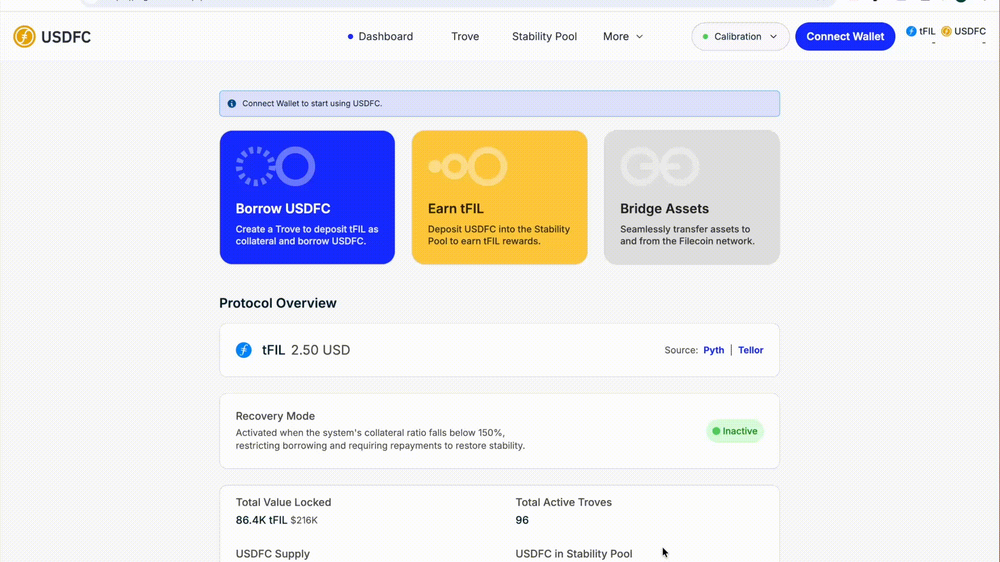

# ⛽ Creating Your First Trove

A **Trove** is your personal collateralized debt position: you lock FIL in it and mint USDFC against it. Each address can have one Trove at a time.

Your **collateral ratio** is the dollar value of your FIL divided by your total USDFC debt. Liquidation closes an eligible Trove and uses collateral to settle its debt.

Before you start, make sure:

* Your wallet is connected to **Filecoin Mainnet**
* You hold enough FIL for the collateral you plan to deposit, plus a little for gas

<figure><figcaption>
Quick walkthrough of this step
</figcaption></figure>

## Step 1 — Connect your wallet

Open the [USDFC app](https://app.usdfc.net), click **Connect Wallet** in the top-right corner, and pick your wallet provider (MetaMask, WalletConnect, etc.).

<figure><figcaption>
The wallet connection dialog
</figcaption></figure>

## Step 2 — Open the Trove page

Go to the **Trove** page. Since you don't have a Trove yet, you'll see the creation form.

<figure><figcaption>
The Trove creation form. The screenshot simplifies Recovery Mode liquidation: below 150% alone does not determine eligibility. See the <a href="../core-mechanics/recovery-mode.md#liquidation-behavior-in-recovery-mode">current liquidation rules</a>.
</figcaption></figure>

## Step 3 — Set collateral and borrow amounts

Enter how much FIL to deposit and how much USDFC to borrow. The app calculates your **collateral ratio** as you type.

* The minimum you can borrow is **200 USDFC**.
* Keep a buffer well above the applicable minimum. Compare 150% and 200% as starting scenarios, and allow more room when FIL is volatile or you cannot react quickly. See [How much buffer is enough?](monitoring-your-position.md#how-much-buffer-is-enough).
* Your **Total debt** will be: borrowed amount + one-time [borrowing fee](../core-mechanics/protocol-fees.md) (0.5% or more; waived in Recovery Mode) + 20 USDFC **Liquidation Reserve**, which you don't repay when you close the Trove.

<figure><figcaption>
Collateral and borrow inputs with the live collateral ratio. The screenshot simplifies Recovery Mode liquidation: below 150% alone does not determine eligibility. See the <a href="../core-mechanics/recovery-mode.md#liquidation-behavior-in-recovery-mode">current liquidation rules</a>.
</figcaption></figure>

**Example, using a 0.5% borrowing fee:** request 200 USDFC and receive 200 USDFC in your wallet. Your total debt is 200 + 1 fee + 20 reserve = **221 USDFC**. FIL worth $442 gives a 200% collateral ratio. Use the actual fee and FIL price shown when you act.

## Step 4 — Confirm


**Before opening, check all three:**

* **Oracle:** opening requires a current primary-oracle price. Read the [Trove page's oracle warning](../core-mechanics/price-oracle.md#checking-oracle-status-in-the-app).
* **Mode and ratios:** in Normal Mode, your new Trove must have a ratio of at least 110% and leave the whole system's ratio at least 150%. In Recovery Mode, your new Trove needs at least 150%.
* **Debt and funds:** review the fee, reserve and total debt, and keep FIL available for gas.

See the [full opening rules](../core-mechanics/recovery-mode.md#what-changes) for the mode and system-ratio checks.


Review the amounts, fee, and resulting ratio, then click **Create Trove and Borrow USDFC** and confirm in your wallet. The USDFC you requested is sent to your wallet in full — the fee and reserve are added to your debt, not deducted from what you receive.

<figure><figcaption>
Review screen before the Create Trove and Borrow USDFC transaction
</figcaption></figure>

## Step 5 — Verify

Once the transaction confirms, your Trove appears on the dashboard and the USDFC lands in your wallet balance.

<figure><figcaption>
A newly created Trove on the dashboard
</figcaption></figure>


**USDFC not showing in your wallet?** On the Dashboard, find "Add USDFC to Wallet" and click **Click here** — or add it manually with the address from [Contracts and Security](../deployed-contracts/).


## Troubleshooting

* **Oracle restriction** — A displayed price does not establish that opening is available. Check the [oracle requirements](../core-mechanics/price-oracle.md#which-actions-remain-available).
* **Create Trove and Borrow USDFC is disabled** — the borrow amount is below 200 USDFC, the ratio is below the minimum, or you don't have enough FIL for the collateral plus gas.
* **Transaction reverts** — the FIL price may have changed, or Recovery Mode may have started or ended. Recovery Mode raises the minimum collateral ratio for a new Trove to 150%. Refresh and re-check the [opening requirements](../core-mechanics/recovery-mode.md#what-changes).
* **"Trove action already performed in the latest block"** — the protocol allows one Trove operation per address per block. Wait for the next block and submit again.
* **Trove not showing after confirmation** — wait for the transaction to finalize, then refresh; check it on [Filfox](https://filfox.info/en) if in doubt.

## Where next

* [Mint additional USDFC](minting-usdfc-step-by-step.md) from the same Trove
* [Manage your collateral](managing-collateral-effectively.md) and understand the ratio thresholds
* [Monitor your position](monitoring-your-position.md) to help avoid liquidation as prices and protocol conditions change
