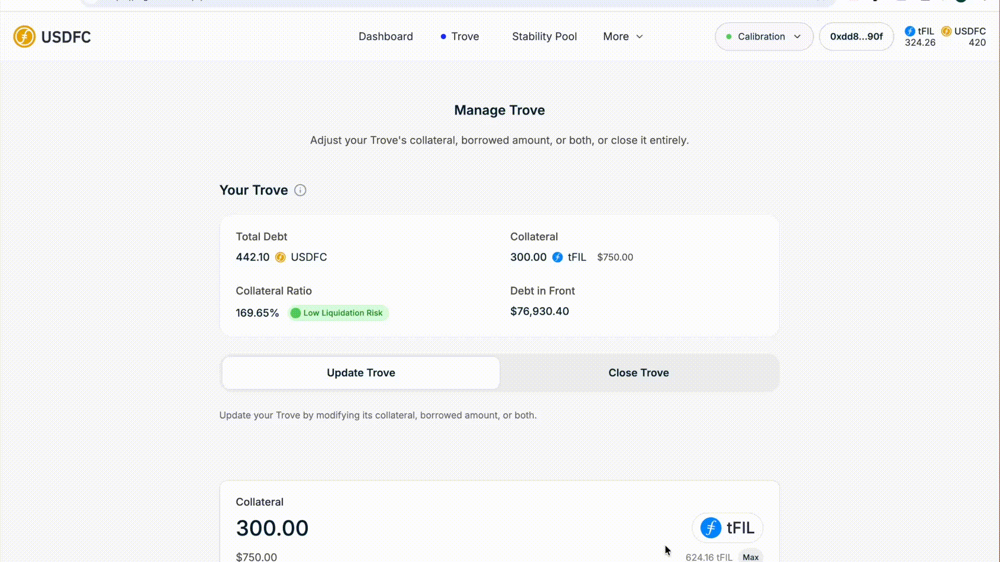

# 🤝 Managing Collateral Effectively

Your collateral ratio is what stands between your Trove and liquidation. This guide covers adjusting collateral in the app and choosing a ratio that fits your risk tolerance.

<figure><figcaption>
Quick walkthrough of this step
</figcaption></figure>

## Step 1 — Open your Trove

In the [USDFC app](https://app.usdfc.net), go to the **Trove** page and review your current collateral, debt, and ratio.

<figure><figcaption>
Your current position on the Trove page
</figcaption></figure>

## Step 2 — Open the Update Trove form

With an open Trove, the **Update Trove** tab is already selected when you land on the Trove page — the adjustment form shows your current collateral and debt.

<figure><figcaption>
The Update Trove form
</figcaption></figure>

## Step 3 — Adjust the collateral amount

In the **Collateral** field, enter the new total:

* **To add:** increase the FIL amount. Your ratio rises and your liquidation price falls. Adding collateral costs only gas — no protocol fee.
* **To withdraw:** decrease the FIL amount. **Withdrawal is blocked in Recovery Mode** and always requires a current primary-oracle price, even when repaying debt at the same time. Check the [withdrawal requirements](../core-mechanics/recovery-mode.md#what-changes) and [oracle requirements](../core-mechanics/price-oracle.md#which-actions-remain-available) before confirming. Withdrawing costs only gas.

<figure><figcaption>
Adding collateral
</figcaption></figure>

<figure><figcaption>
Withdrawing collateral
</figcaption></figure>

## Step 4 — Confirm and verify

Before signing, check the resulting ratios:

* **Normal Mode:** any adjustment must leave your ratio at least 110% and the whole system's ratio at least 150%.
* **Recovery Mode:** you can add FIL, but cannot withdraw it. If you also borrow, your resulting ratio must be at least 150% and no lower than before.
* **Oracle:** read the [Trove page's price warning](../core-mechanics/price-oracle.md#checking-oracle-status-in-the-app). Adding FIL needs a usable price; any withdrawal or debt increase needs the primary price.

Click **Update Trove**, confirm in your wallet, and check the updated position. Withdrawn FIL goes straight to your wallet balance.

<figure><figcaption>
Wallet confirmation
</figcaption></figure>

<figure><figcaption>
Updated Trove details
</figcaption></figure>

## Choosing a collateral ratio

The app classifies your ratio the same way it displays risk:

| Ratio              | App label     | Approx. FIL drop to 110% in Normal Mode                      |
| ------------------ | ------------- | ------------------------------------------------------------ |
| 200% and above     | Very Low risk | 45% or more                                                  |
| 150% to under 200% | Low risk      | 27% – 45%                                                    |
| 120% to under 150% | Medium risk   | 8% – 27%                                                     |
| Below 120%         | High risk     | Less than 8%                                                 |
| Below 110%         | —             | Eligible for [liquidation](../core-mechanics/liquidation.md) |

The drop figures assume Normal Mode and unchanged collateral and debt. **Recovery Mode changes liquidation eligibility, including for Troves above 110%.** See the [complete liquidation rules](../core-mechanics/recovery-mode.md#liquidation-behavior-in-recovery-mode). For the calculation and its limits, use [Monitoring Your Position](monitoring-your-position.md#liquidation-price-calculate-this-yourself).


There is no ratio that removes risk entirely — a deep enough FIL drop can threaten any Trove. Decide how closely you can realistically monitor the market, and size your buffer to match. See the [Risk Disclaimer](../../resources/legal/risk-disclaimer.md).


## Troubleshooting

* **Oracle restriction** — A displayed price does not establish that withdrawal is available. Check the [oracle requirements](../core-mechanics/price-oracle.md#which-actions-remain-available).
* **Withdrawal reverts** — check the current mode and resulting Trove and system ratios against the [withdrawal requirements](../core-mechanics/recovery-mode.md#what-changes).
* **Update Trove is disabled** — check that the amounts changed and that your wallet has enough FIL for gas.
* **Ratio didn't update after the transaction** — refresh the page; the app re-reads your Trove on load.

## Repaying debt and closing your Trove

* **Partial repayment** — in the **Update Trove** form, reduce the **Borrowed Amount** by the USDFC you want to repay and click **Update Trove**. Net debt (excluding the 20 USDFC reserve) must stay at or above 200 USDFC. Repaying has no fee.
* **Before closing** — **closure is blocked in Recovery Mode**. Check the [closing requirements](../core-mechanics/recovery-mode.md#what-changes) and [oracle availability](../core-mechanics/price-oracle.md#which-actions-remain-available). Partial repayment may remain available, subject to those checks and the minimum net debt above.
* **Closing** — in Normal Mode, closure must leave the whole system's ratio at least 150%, and a usable oracle price is required. Open the **Close Trove** tab and click **Repay & Close Trove**. You repay your current total debt minus the 20 USDFC reserve, and all collateral returns to your wallet.

Before closing, compare the required repayment with your wallet balance. Borrowing fees and any debt redistributed to you from liquidations remain owed, so you usually need more USDFC than you originally minted. Obtain any shortfall before submitting, for example through a swap or transfer. FIL gains from the Stability Pool would first need to be swapped into USDFC.

## Where next

* [Monitor your position](monitoring-your-position.md) — thresholds only help if you're watching them
* [Recovery Mode](../core-mechanics/recovery-mode.md) — what changes when the whole system is under-collateralized
