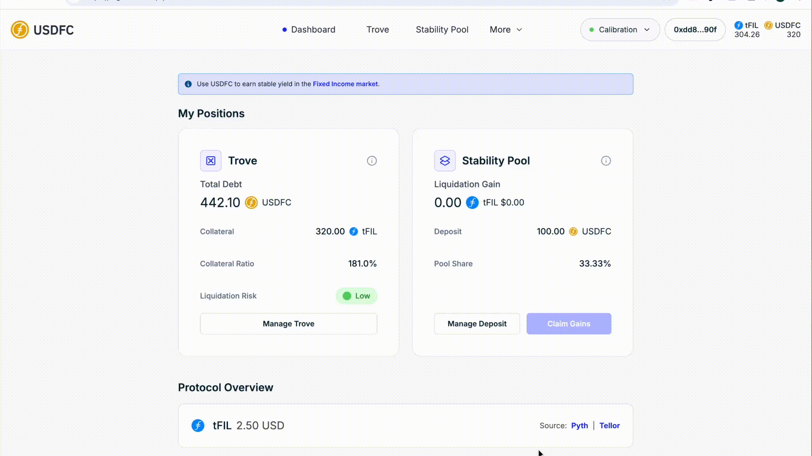

# 🏦 Monitoring Your Position

FIL price changes move your Trove's collateral ratio. Use the Dashboard and Trove page to track debt, collateral and the system conditions that affect liquidation.

<figure><figcaption>
Calibration testnet walkthrough, recorded before RedStone replaced Pyth.
</figcaption></figure>

## Step 1 — Check the Dashboard

The **Dashboard** page of the [USDFC app](https://app.usdfc.net) shows your Trove and Stability Pool positions alongside protocol-wide statistics.

**My Positions**

| Item             | What it means                                                                                                                                                                                                                                                                                       |
| ---------------- | --------------------------------------------------------------------------------------------------------------------------------------------------------------------------------------------------------------------------------------------------------------------------------------------------- |
| Total Debt       | Your current outstanding balance: borrowed USDFC + borrowing fees + the 20 USDFC Liquidation Reserve, plus any debt redistributed to your Trove from liquidations, minus repayments and redemptions against you ([details](../core-mechanics/the-trove-system.md#how-total-debt-changes-over-time)) |
| Collateral       | FIL locked in your Trove                                                                                                                                                                                                                                                                            |
| Collateral Ratio | Collateral value ÷ Total Debt — see below                                                                                                                                                                                                                                                           |
| Liquidation Risk | The app's label for your ratio: Very Low (200%+), Low (150–<200%), Medium (120–<150%), High (<120%)                                                                                                                                                                                                 |
| Liquidation Gain | FIL credited to you from liquidations, waiting to be claimed                                                                                                                                                                                                                                        |
| Deposit          | Your remaining USDFC in the Stability Pool (it shrinks as liquidations consume it)                                                                                                                                                                                                                  |
| Pool Share       | Your deposit as a share of the whole pool — your cut of every liquidation                                                                                                                                                                                                                           |

**Protocol Overview**

| Item                    | What it means                                                                                                                  |
| ----------------------- | ------------------------------------------------------------------------------------------------------------------------------ |
| FIL price / Source      | The FIL/USD price the protocol is using and which oracle it comes from — see [Price Oracle](../core-mechanics/price-oracle.md) |
| Recovery Mode           | Whether the system is in [Recovery Mode](../core-mechanics/recovery-mode.md) (Active / Inactive)                               |
| Total Value Locked      | All FIL collateral in the protocol                                                                                             |
| Total Active Troves     | Number of open Troves                                                                                                          |
| USDFC Supply            | Total USDFC in circulation                                                                                                     |
| USDFC in Stability Pool | How much of the supply is backing liquidations (and the percentage)                                                            |
| Borrowing Fee           | The fee you'd pay to mint right now — 0.5% + Base Rate, capped at 5%; 0.00% during Recovery Mode                               |
| Total Collateral Ratio  | The system-wide collateral ratio, which determines whether [Recovery Mode](../core-mechanics/recovery-mode.md) is active       |

<figure><figcaption>
The Dashboard with your position and protocol statistics
</figcaption></figure>

### Find the checks you need

On **Dashboard → Protocol Overview**, read **Recovery Mode**, **Total Collateral Ratio**, and **USDFC in Stability Pool**. Your own ratio is on the **Trove** page.

The overview also shows a FIL price and RedStone/Tellor source links, but it does not show a freshness timestamp. Before acting, open the **Trove** page and read any price warning. See [what the oracle warnings mean](../core-mechanics/price-oracle.md#checking-oracle-status-in-the-app). The Trove warning identifies action restrictions; the source links provide background.

## Step 2 — Know your metrics

The Trove page shows your collateral, debt, collateral ratio, liquidation risk, and debt in front. One number worth tracking — your liquidation price — is **not** displayed, so calculate it yourself from the figures shown.

<figure><figcaption>
Your Trove metrics as shown in the app
</figcaption></figure>

### Collateral Ratio

Your individual collateral ratio (ICR) compares the value of your Trove's FIL collateral with its total debt:

$$
\text{Collateral Ratio} = \frac{\text{Collateral Value in USD}}{\text{Debt in USDFC}} \times 100\%
$$

The total collateral ratio (TCR) measures collateral value against debt across all Troves. It determines whether [Recovery Mode](../core-mechanics/recovery-mode.md) is active.

The app labels the ranges: 200% and above very low risk, 150% to under 200% low, 120% to under 150% medium, below 120% high.

### How much buffer is enough? 

Keep your ratio comfortably above 110% in Normal Mode; opening in Recovery Mode requires at least 150%. These minimum checks are not buffer targets. Choose room for price falls and the time you need to add collateral or repay.

Illustrative buffer: with FIL quantity and total debt unchanged, a 25% FIL price fall takes a 200% ratio to 150% (200% × 0.75), while a 150% ratio falls to 112.5% (150% × 0.75). In Recovery Mode, a Trove at or above 110% but below TCR can be liquidated when the Stability Pool covers its entire debt. Choose your buffer with both price risk and the Recovery Mode rules in mind.

The app's risk labels are not safety guarantees. Reassess your buffer when debt, collateral, oracle availability or system conditions change.

### Liquidation Price (calculate this yourself)

Not shown in the app. This calculation gives the **Normal Mode 110% boundary**, using your current total debt and collateral:

$$
\text{Liquidation Price} = \frac{\text{Debt in USDFC} \times 1.1}{\text{Collateral in FIL}}
$$

Liquidation in Normal Mode requires an ICR below 110%, rather than exactly equal to it.


**This calculation covers Normal Mode only.** Recovery Mode can make Troves above 110% eligible for liquidation. Check the [complete liquidation rules](../core-mechanics/recovery-mode.md#liquidation-behavior-in-recovery-mode) using current ICR, TCR and Stability Pool balance, and check [oracle availability](../core-mechanics/price-oracle.md#which-actions-remain-available). Changes to debt, collateral or the oracle price also change your exposure.


### Debt in front

Shown on the Trove page: the total debt of Troves with lower collateral ratios than yours.

* **What it tells you:** [redemptions](redeeming-usdfc.md) start with the lowest-ratio eligible Troves. A small "debt in front" means yours is near the front of that queue.
* **What happens to you:** collateral is removed to reduce your debt at the oracle price, without a fee charged to you. This can happen even if you did not want to sell collateral.
* **What changes your place:** raising your ratio moves you farther back in the queue.

### Recovery Mode

Not a metric but a state: when the system enters Recovery Mode, the app displays a prominent notice on the Dashboard — you don't need an external source to know.

## Step 3 — Set up price alerts

The app doesn't send notifications, so put an alert where you'll see it:

1. Calculate the Normal Mode 110% price boundary using current total debt and collateral.
2. Set a price alert above that boundary as an early prompt to review your position. Check the system mode, TCR and Stability Pool balance in Protocol Overview, and check the [Trove page's oracle warning](../core-mechanics/price-oracle.md#checking-oracle-status-in-the-app) separately.
3. Reassess when debt, collateral or system conditions change. Before adding collateral or repaying, check the [adjustment requirements](../core-mechanics/recovery-mode.md#what-changes) and [oracle availability](../core-mechanics/price-oracle.md#which-actions-remain-available).

## Step 4 — Match your check-in rhythm to your risk

* **Watch changing conditions:** recheck after sharp FIL price moves, oracle incidents, Recovery Mode notices, or changes to your debt or collateral.
* **Track the system as well as your Trove:** check your Trove's collateral ratio alongside the protocol's total collateral ratio. Also check **USDFC in Stability Pool** in Protocol Overview and any price warning on the Trove page.
* **Plan before the buffer is tight:** set alerts you can respond to and keep access to funds you may need for an adjustment.

When FIL falls, adding collateral or repaying debt can improve your ratio. Use [Managing Collateral Effectively](managing-collateral-effectively.md) for the adjustment steps and warnings before acting. Withdrawing collateral or [minting more USDFC](minting-usdfc-step-by-step.md) reduces your buffer.

## Where next

* [Managing Collateral Effectively](managing-collateral-effectively.md) — the mechanics of adjusting your position
* [Redeeming USDFC](redeeming-usdfc.md) — what redemption means for Trove owners
* [Recovery Mode](../core-mechanics/recovery-mode.md) — the rules that apply system-wide
